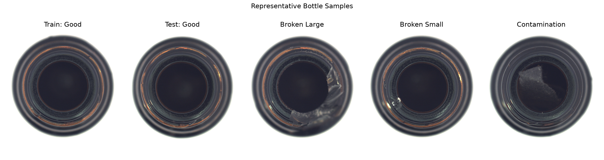
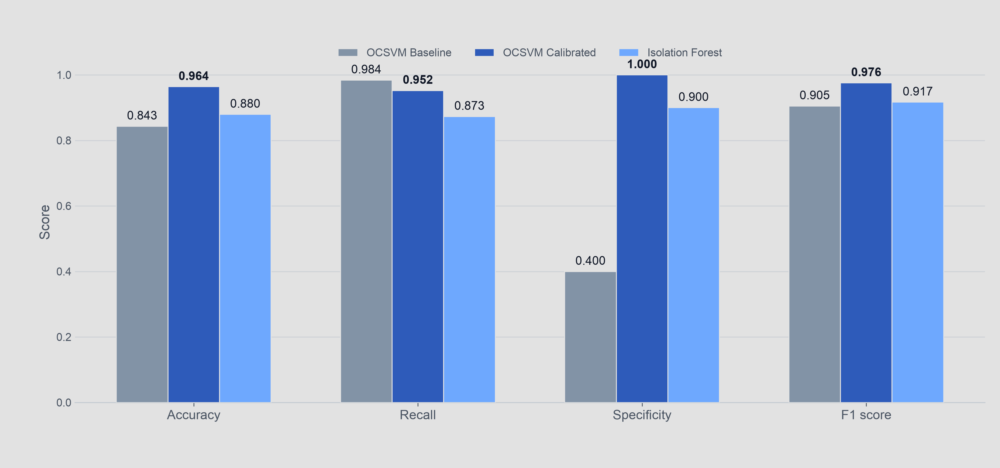
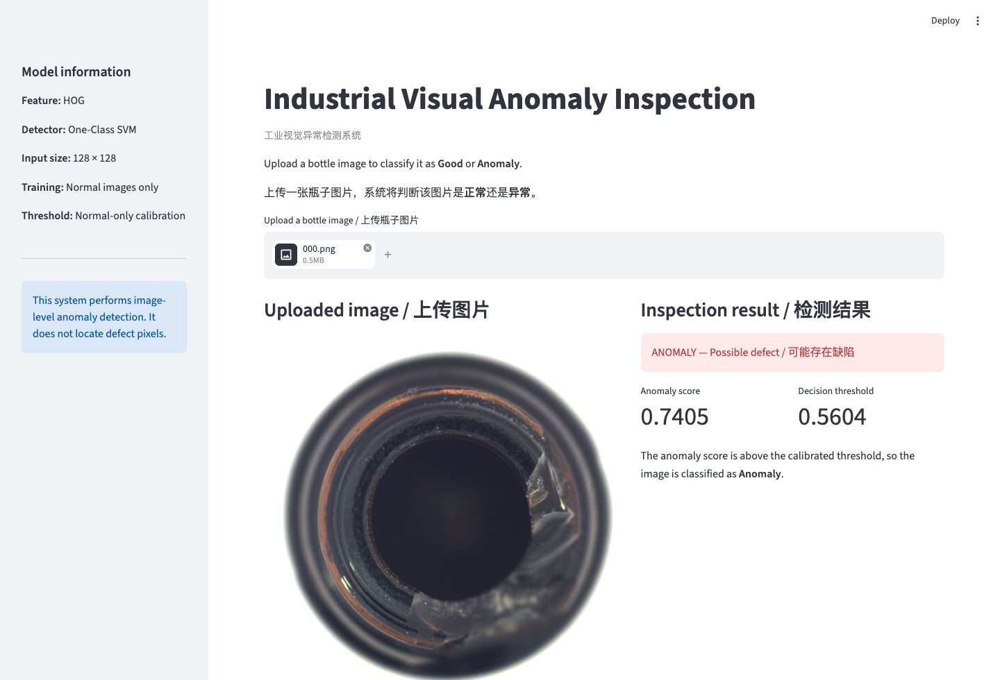

# Industrial Visual Anomaly Inspection｜工业视觉异常检测

[](https://bottle-anomaly-inspection.streamlit.app/)
[](https://github.com/Dongye-Yuan/industrial-visual-anomaly-inspection/actions/workflows/ci.yml)
[](https://www.python.org/)
[](https://scikit-learn.org/)

**Live demo / 在线演示:** [bottle-anomaly-inspection.streamlit.app](https://bottle-anomaly-inspection.streamlit.app/)

**English** | [中文](#中文)

## English

An end-to-end, normal-only, image-level anomaly detection prototype for fixed top-view inspection of the bottle-opening region in the MVTec AD bottle category. The repository covers dataset exploration, handcrafted feature extraction, one-class model training, threshold calibration, evaluation, model comparison, artifact persistence, and single-image inference.

The deployed model classifies a compatible image as **Good** or **Anomaly**. Its validated scope is the bottle opening and surrounding rim under a camera view similar to the dataset; it is not a general full-bottle, bottle-side, or bottle-bottom inspection system, and it does not localise defect pixels.

### Engineering ownership

This repository presents my independent end-to-end implementation. I designed and built:

- dataset validation and exploratory analysis;
- the HOG feature extraction pipeline;
- One-Class SVM and Isolation Forest training workflows;
- normal-only threshold calibration and model evaluation;
- model persistence and single-image inference;
- the bilingual Streamlit interface; and
- reproducibility documentation and presentation-ready visualisations.



### Why this project matters

Industrial defects are rare and evolve over time, while normal products are comparatively easy to collect. This project therefore learns normal bottle appearance without requiring defective training samples. A calibrated decision threshold then balances defect detection against false rejection of acceptable products.

### Solution at a glance

```text
Bottle image
    → grayscale and resize to 128 × 128
    → 1,764-dimensional HOG feature vector
    → StandardScaler + one-class detector
    → anomaly score
    → calibrated threshold
    → Good or Anomaly
```

Three configurations were evaluated:

- HOG + One-Class SVM baseline
- HOG + calibrated One-Class SVM
- HOG + calibrated Isolation Forest

The calibrated One-Class SVM was selected as the final model.

### Key results

| Model | Accuracy | Recall | Specificity | F1 score | Latency |
|---|---:|---:|---:|---:|---:|
| OCSVM baseline | 0.8434 | 0.9841 | 0.4000 | 0.9051 | 12.11 ms/image |
| **OCSVM calibrated** | **0.9639** | **0.9524** | **1.0000** | **0.9756** | **11.94 ms/image** |
| Isolation Forest | 0.8795 | 0.8730 | 0.9000 | 0.9167 | 11.99 ms/image |



On the available test set, the selected model accepted all 20 good bottles and detected 60 of 63 anomalous bottles. Its three false negatives were low-contrast contamination samples, which reveals the main limitation of grayscale HOG features.

### Dataset

The project uses the **MVTec AD bottle** category:

In this dataset, the visible inspection region is the bottle opening and surrounding rim captured from a consistent top view. Results should therefore be interpreted within that imaging setup.

| Split and category | Images |
|---|---:|
| Train / good | 209 |
| Test / good | 20 |
| Test / broken large | 20 |
| Test / broken small | 22 |
| Test / contamination | 21 |

The dataset is intentionally excluded from Git. Place it at:

```text
data/mvtec_ad/bottle/
├── train/good/
├── test/good/
├── test/broken_large/
├── test/broken_small/
├── test/contamination/
└── ground_truth/
```

### Quick start

Create and activate a virtual environment:

```bash
python3 -m venv .venv
source .venv/bin/activate
python -m pip install -r requirements.txt
```

Windows PowerShell activation:

```powershell
python -m venv .venv
.\.venv\Scripts\Activate.ps1
python -m pip install -r requirements.txt
```

Run the full workflow:

```bash
python src/explore_dataset.py
python src/train_hog_ocsvm.py
python src/train_hog_ocsvm_calibrated.py
python src/train_hog_isolation_forest.py
python src/compare_models.py
```

Inspect one image with the saved final model:

```bash
python src/predict_image.py data/mvtec_ad/bottle/test/good/000.png
python src/predict_image.py data/mvtec_ad/bottle/test/broken_large/000.png
```

Example output:

```text
Prediction result
  Anomaly score: 0.7405
  Threshold: 0.5604
  Predicted label: Anomaly
```

### Automated tests

The repository includes data-independent unit tests for the HOG feature contract, calibrated-threshold decisions, missing-input validation, and the versioned model-artifact schema:

```bash
python -m unittest discover -s tests -v
```

GitHub Actions runs the tests and Python syntax checks automatically on every push to `main` and every pull request. The workflow does not download the MVTec AD dataset.

### Web demo

**Public deployment:** [Open the live bilingual demo](https://bottle-anomaly-inspection.streamlit.app/)

Launch the bilingual Streamlit interface locally:

```bash
streamlit run app/app.py
```

Upload a compatible top-view PNG or JPEG image of the bottle-opening region to view the image-level decision, anomaly score, and calibrated threshold.



### Repository structure

```text
industrial-visual-anomaly-inspection/
├── app/
│   └── app.py                    # bilingual Streamlit demo
├── data/                         # local dataset, ignored by Git
├── docs/                         # developer guide and demo images
├── outputs/                      # metrics, plots, predictions, model artifacts
├── src/
│   ├── explore_dataset.py
│   ├── train_hog_ocsvm.py
│   ├── train_hog_ocsvm_calibrated.py
│   ├── train_hog_isolation_forest.py
│   ├── compare_models.py
│   └── predict_image.py
├── requirements.txt
└── README.md
```

### Documentation

- [Developer Guide｜开发者文档](docs/DEVELOPER_GUIDE.md)

---

## 中文

这是一个面向固定俯视视角瓶口区域的端到端、仅正常样本训练、图片级异常检测原型。项目使用 MVTec AD bottle 类别完成数据探索、HOG 特征提取、单类模型训练、阈值校准、性能评估、模型对比、模型保存以及单张图片推理。

部署模型会把符合输入条件的图片判断为 **Good** 或 **Anomaly**。目前验证范围是与数据集拍摄条件相近的瓶口及周围边缘区域，不代表整瓶、瓶身侧面或瓶底质检能力，也不能定位缺陷的具体像素位置。

### 个人实现

本仓库展示了我独立完成的端到端实现，包括：

- 数据集验证与探索性分析；
- HOG 特征提取流水线；
- One-Class SVM 与 Isolation Forest 训练流程；
- 仅使用正常样本的阈值校准与模型评估；
- 模型保存与单图推理；
- 中英双语 Streamlit 界面；
- 可复现技术文档与演示级可视化。

### 项目价值

工业缺陷样本通常数量少、类型变化快，而正常产品数据相对容易获取。因此，本项目只使用正常瓶子图片训练模型，不依赖缺陷训练样本。随后利用独立的正常校准集确定异常阈值，在缺陷检出率与正常产品误报率之间取得平衡。

### 技术流程

```text
瓶子图片
    → 灰度化并缩放至 128 × 128
    → 提取 1,764 维 HOG 特征
    → StandardScaler + 单类异常检测模型
    → 计算异常分数
    → 与校准阈值比较
    → 输出 Good 或 Anomaly
```

项目比较了三种配置：

- HOG + One-Class SVM 基线模型
- HOG + 校准阈值的 One-Class SVM
- HOG + 校准阈值的 Isolation Forest

最终选择校准后的 One-Class SVM 作为部署模型。

### 核心结果

| 模型 | 准确率 | 召回率 | 特异度 | F1 分数 | 推理延迟 |
|---|---:|---:|---:|---:|---:|
| OCSVM 基线 | 0.8434 | 0.9841 | 0.4000 | 0.9051 | 12.11 ms/张 |
| **校准 OCSVM** | **0.9639** | **0.9524** | **1.0000** | **0.9756** | **11.94 ms/张** |
| Isolation Forest | 0.8795 | 0.8730 | 0.9000 | 0.9167 | 11.99 ms/张 |

在当前测试集上，最终模型正确接受了全部 20 张正常图片，并检出了 63 张异常图片中的 60 张。3 个漏检样本均为低对比度污染，这也说明仅使用灰度 HOG 特征对细微颜色和纹理异常的表达能力有限。

### 快速运行

安装依赖并运行完整流程：

```bash
python3 -m venv .venv
source .venv/bin/activate
python -m pip install -r requirements.txt

python src/explore_dataset.py
python src/train_hog_ocsvm.py
python src/train_hog_ocsvm_calibrated.py
python src/train_hog_isolation_forest.py
python src/compare_models.py
```

使用最终模型检测单张图片：

```bash
python src/predict_image.py path/to/image.png
```

程序会输出异常分数、校准阈值以及最终判断结果。分数高于阈值时输出 `Anomaly`，否则输出 `Good`。

### 自动测试

仓库提供不依赖原始数据集的单元测试，覆盖 HOG 特征维度、校准阈值两侧的分类结果、输入文件校验以及已保存模型的字段约定：

```bash
python -m unittest discover -s tests -v
```

GitHub Actions 会在每次向 `main` 推送代码以及创建 Pull Request 时自动执行测试和 Python 语法检查，测试过程不下载 MVTec AD 数据集。

### 可视化网页演示

**公开在线演示：**[点击打开中英双语 Streamlit 应用](https://bottle-anomaly-inspection.streamlit.app/)

在本地启动中英双语 Streamlit 界面：

```bash
streamlit run app/app.py
```

上传与数据集视角相近的瓶口区域 PNG 或 JPEG 图片后，页面会显示图片级判断、异常分数和校准阈值。按 `Control + C` 可以停止本地服务。

### 设计亮点

- 只使用正常样本训练，符合真实工业缺陷数据稀缺的场景。
- 校准阈值只使用留出的正常图片，不使用测试标签。
- 保存了预处理器、模型、阈值、图片尺寸和 HOG 参数，确保推理流程一致。
- 输出指标、预测结果、混淆矩阵、ROC/PR 曲线和模型对比图。
- 提供独立的单图预测入口，能够验证训练后模型的实际可用性。

### 已知限制与改进方向

- 当前只进行图片级异常检测，尚未定位缺陷像素区域。
- 灰度 HOG 对颜色变化和低对比度污染不够敏感。
- 当前实验只覆盖固定俯视视角下的 MVTec AD bottle 瓶口区域，不能直接代表整瓶、瓶身侧面或瓶底检测能力。
- 后续可增加颜色直方图、LBP、预训练深度特征和像素级定位方法。

详细的复现、维护和扩展说明请阅读：[开发者文档](docs/DEVELOPER_GUIDE.md)。

## Project status｜项目状态

The training, evaluation, model comparison, saved-model inference, and bilingual web demo workflows are complete. The next technical priorities are stronger texture or colour representations and pixel-level defect localisation.

训练、评估、模型对比、模型保存与推理以及中英双语网页演示流程均已完成。下一阶段的技术重点是增强颜色与纹理特征，并实现像素级缺陷定位。
